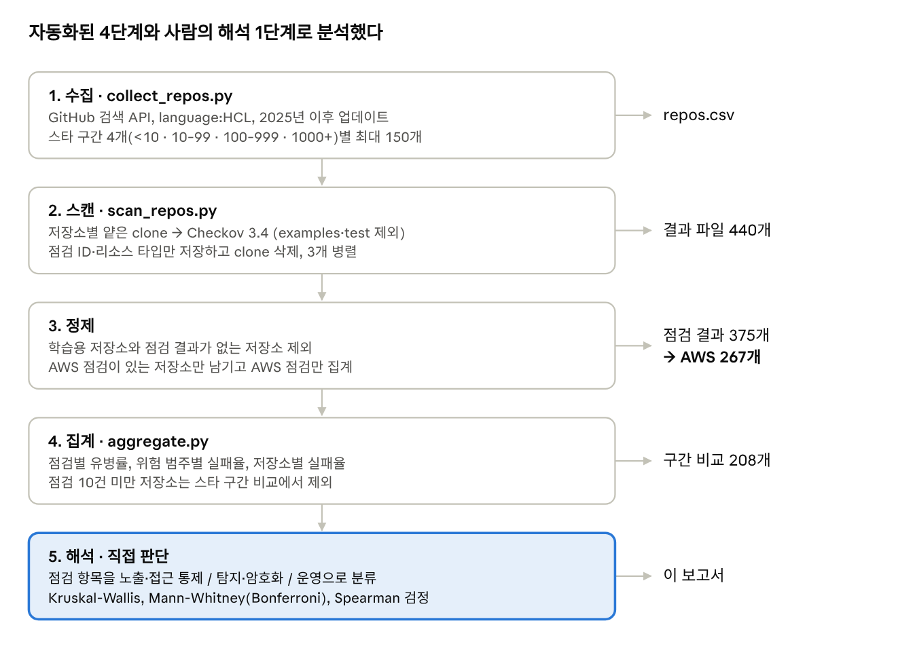
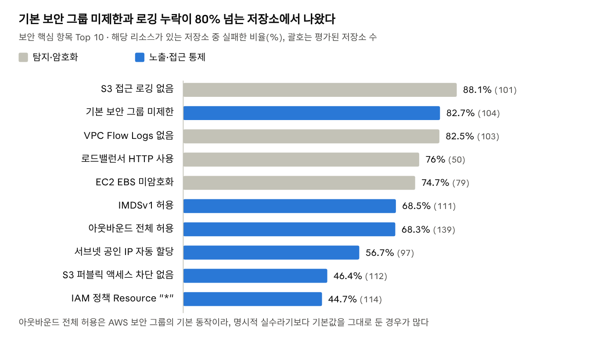
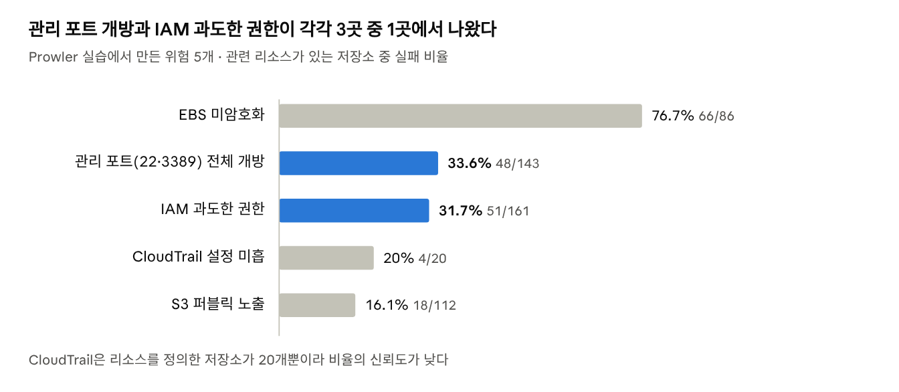
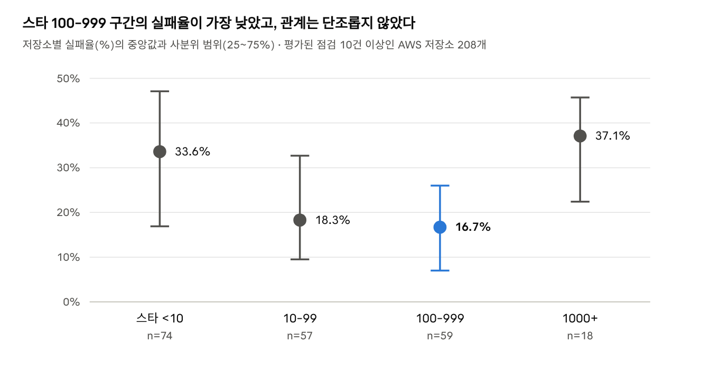

> **TL;DR**
> - AWS 리소스가 있는 공개 Terraform 저장소 267개 중 **79%가 Checkov 점검을 1건 이상 실패**했다.
> - 실패 Top 10 대부분은 운영·비용 권고였다. 보안만 따로 보면 **기본 보안 그룹 미제한, 로깅 누락, IMDSv1 허용**이 가장 흔했다.
> - 보안 그룹을 정의한 저장소 **3곳 중 1곳이 22·3389 포트를 인터넷 전체에 열었다.**
> - 스타가 많다고 더 안전하지는 않았다. 실패율은 스타 100–999 구간에서 가장 낮은 **U자 모양**이었다.

## 왜 해 봤나

지난번에 [Prowler로 AWS 계정을 점검하는 실습]({{ '/posts/prowler-aws-cspm-iac/' | relative_url }})을 했다. Terraform으로 일부러 취약한 환경(퍼블릭 S3, 0.0.0.0/0으로 열린 SSH, `*:*` IAM 정책 등)을 만들고, 점검하고, 코드로 고쳤다.

끝내고 나니 궁금해졌다. **내가 일부러 만든 실수를, 실제 사람들은 얼마나 하고 있을까?**

Prowler는 이미 배포된 계정을 본다. 반대로 배포하기 전에 코드에서 잡는 도구가 Checkov 같은 IaC 정적 분석기다. 그래서 GitHub의 공개 Terraform 코드를 대량으로 모아 Checkov로 돌려 보기로 했다.

## 어떻게 했나


_수집부터 집계까지는 스크립트로 자동화했고, 해석은 직접 했다._

### 1. 수집: 스타 구간별로 골고루

GitHub 검색 API로 `language:HCL` 저장소를 모았다. 포크와 보관(archived) 저장소는 빼고, 2025년 이후 업데이트된 것만 골랐다.

나중에 "스타가 많은 저장소가 더 안전한가?"를 보고 싶어서 스타 구간 4개(<10, 10–99, 100–999, 1000+)로 나눠 구간마다 최대 150개씩 모았다. 검색 API는 질의 하나에 1,000건까지만 돌려주기 때문에, 그냥 검색하면 인기 저장소 위주로 쏠린다.

### 2. 스캔: 얕게 받고, 스캔하고, 지운다

저장소마다 `git clone --depth 1`로 최신 커밋만 받고, Checkov로 스캔한 뒤 바로 지웠다. 결과 파일에는 점검 ID, 리소스 타입, 파일 경로만 남기고 **코드 원문은 저장하지 않았다.** 하드코딩된 키 같은 민감한 값이 내 PC에 쌓이지 않게 하기 위해서다.

```bash
checkov -d <repo> --framework terraform -o json --compact \
        --skip-download --soft-fail \
        --skip-path examples --skip-path test
```

3개를 병렬로 돌렸고, 중간에 끊겨도 이어서 실행되게 만들었다. 전체 스캔에는 1시간 남짓 걸렸다.

### 3. 정제와 집계

- 일부러 취약하게 만든 학습용 저장소(TerraGoat 같은 것)는 이름과 설명으로 걸러 뺐다.
- **AWS 점검이 평가된 저장소만** 남기고 AWS 점검만 집계했다. 이유는 뒤의 삽질 기록에 적었다.
- 큰 플랫폼 저장소 하나가 수천 건의 점검을 만들기 때문에, 실패 건수를 그냥 합치지 않았다. 대신 **"실패한 저장소 비율"**과 **"저장소별 실패율"**을 지표로 썼다.

최종적으로 스캔 결과 440개 → 점검 결과가 있는 375개 → **AWS 저장소 267개**를 분석했다.

## 결과 1: Top 10의 대부분은 보안 문제가 아니었다

| 순위 | 점검 | 내용 | 실패 비율 | 성격 |
| --- | --- | --- | --- | --- |
| 1 | CKV_AWS_144 | S3 교차 리전 복제 없음 | 36.3% | 운영·가용성 |
| 2 | CKV_AWS_382 | 보안 그룹 아웃바운드 전체 허용 | 35.6% | 보안 (AWS 기본값) |
| 3 | CKV2_AWS_62 | S3 이벤트 알림 없음 | 34.8% | 운영 |
| 4 | CKV_AWS_145 | S3 KMS 기본 암호화 없음 | 34.5% | 암호화 강화 권고 |
| 5 | CKV_AWS_126 | EC2 상세 모니터링 꺼짐 | 34.1% | 운영 |
| 6 | CKV_AWS_23 | 보안 그룹 설명 누락 | 33.7% | 관리 |
| 7 | CKV_AWS_135 | EC2 EBS 최적화 꺼짐 | 33.3% | 성능 |
| 8 | CKV_AWS_18 | S3 접근 로깅 없음 | 33.3% | **보안 (탐지)** |
| 9 | CKV2_AWS_12 | 기본 보안 그룹 미제한 | 32.2% | **보안 (노출)** |
| 10 | CKV2_AWS_11 | VPC Flow Logs 없음 | 31.8% | **보안 (탐지)** |

_비율은 AWS 저장소 267개 중 해당 점검에 실패한 저장소의 비율._

처음에 이 표를 보고 좀 당황했다. 교차 리전 복제나 EBS 최적화를 안 했다고 "보안 실패"라고 부르기는 어렵다. **오픈소스 Checkov는 심각도를 제공하지 않아서** 운영 권고와 보안 위험이 같은 무게로 섞인다.

S3 KMS 암호화도 조심해서 읽어야 한다. 2023년부터 S3는 기본으로 SSE-S3 암호화를 적용하기 때문에, 이 점검에 실패했다고 데이터가 평문으로 저장되는 건 아니다.

## 결과 2: 보안만 따로 보면

그래서 상위 점검을 하나씩 읽고 직접 분류했다.

- **노출·접근 통제**: 외부 노출이나 권한 오용으로 이어지는가
- **탐지·암호화**: 사고를 탐지하거나 데이터를 보호하는가
- **운영**: 가용성·비용·관리 문제인가

그리고 보안 항목만 골라, 이번에는 **그 리소스를 실제로 쓰는 저장소 중 몇 %가 틀렸는지**를 봤다.



- **로깅 누락**이 가장 흔했다. S3 접근 로깅이 없는 저장소가 88%, VPC Flow Logs가 없는 저장소가 83%였다. 사고가 나도 추적할 수 없는 상태다.
- **기본 보안 그룹 미제한**이 83%였다. 대부분 VPC를 만들면서 default SG를 건드리지 않은 경우다.
- **IMDSv1 허용**이 69%였다. IMDSv1은 SSRF 취약점으로 EC2의 IAM 자격 증명이 털리는 대표적인 경로라서, 개인적으로는 가장 먼저 고칠 항목이라고 생각한다.

## 결과 3: Prowler 실습에서 만든 취약점은 얼마나 흔할까

처음 질문으로 돌아가 보자. Prowler 실습에서 일부러 만든 위험 5개를 Checkov 점검 ID로 대응시켜 봤다.



보안 그룹을 정의한 저장소 **3곳 중 1곳이 22·3389 포트를 0.0.0.0/0에 열었고**, IAM 정책도 비슷한 비율로 과도한 권한을 주고 있었다. 실습 시나리오가 결코 과장이 아니었던 셈이다.

다만 두 가지는 조심해서 읽어야 한다.

- **EBS 미암호화 76.7%는 과대 추정일 가능성이 크다.** 코드에 `encrypted = true`가 없어도 계정 단위 EBS 기본 암호화가 켜져 있으면 실제로는 암호화된다. 이 설정은 코드 밖에 있어서 Checkov는 알 수 없다. Prowler의 `ec2_ebs_default_encryption` 같은 런타임 점검이 필요한 이유다.
- **CloudTrail은 정의한 저장소가 267개 중 20개뿐이었다.** Prowler 실습에서 가장 중요한 High 항목이 "CloudTrail 미설정"이었는데, 리소스가 아예 없는 상태는 정적 분석으로 탐지할 수 없다.

**정적 분석(Checkov)과 런타임 점검(Prowler)은 서로 대체재가 아니라 보완재**라는 걸 데이터로 확인한 셈이다.

## 결과 4: 스타가 많으면 더 안전할까?



아니었다. 실패율 중앙값은 스타 100–999 구간에서 가장 낮았고(16.7%), 10개 미만(33.6%)과 1000개 이상(37.1%)에서 더 높은 U자 모양이었다.

우연인지 확인하려고 통계 검정을 했다. 저장소별 실패율은 한쪽으로 치우친 분포이고 구간별 표본 수(18~74개)도 달라서, 평균 대신 순위를 쓰는 비모수 검정을 골랐다.

| 검정 | 결과 |
| --- | --- |
| 4개 구간 전체 (Kruskal-Wallis) | H = 23.2, p < 0.001 |
| <10 vs 100–999 (Mann-Whitney, Bonferroni 보정) | p = 0.0003 |
| 100–999 vs 1000+ | p = 0.0035 |
| 나머지 4개 쌍 | 보정 후 유의하지 않음 |
| 스타 수와 실패율 (Spearman) | ρ = −0.17, p = 0.017 |

구간 간 차이는 통계적으로 의미가 있었다. 하지만 숨은 변수가 있다. 스타가 많을수록 저장소가 크고(평가된 점검 수 중앙값 86 → 155 → 274 → 362건), 점검 수가 많은 저장소일수록 실패율이 낮았다(ρ = −0.24). 스타 자체보다는 **저장소의 규모와 성격**(개인 연습 코드인지, 관리되는 모듈인지)이 영향을 줬을 가능성이 크다. 1000+ 구간은 18개뿐이라 왜 다시 높아지는지는 더 봐야 한다.

## 삽질 기록과 배운 점

**1. 예제 코드가 결과를 부풀린다**
시범 실행에서 한 S3 모듈 저장소가 FAIL 170건을 냈다. 열어 보니 대부분 `examples/` 폴더의 최소 설정 예제였다. `--skip-path examples`를 주자 7건으로 줄었다. 대량 분석에서는 "무엇을 스캔 범위에 넣을지"가 결과를 크게 바꾼다.

**2. `language:HCL`은 클라우드 코드만 있는 게 아니다**
처음 20개를 돌려 보니 `homelab`, `gitops` 같은 이름이 많았다. Proxmox, Kubernetes, Cloudflare 같은 provider를 쓰는 홈랩 코드인데, Checkov는 이런 provider에 대한 정책이 거의 없어서 리소스가 200개 넘어도 점검이 50건뿐인 경우가 있었다. 그래서 AWS 점검이 평가된 저장소만 따로 분석하도록 필터를 추가했다.

**3. 도구의 Python 버전 제약**
Checkov는 Python 3.9~3.12만 지원한다. 이전 Prowler 실습 때 리눅스 VM의 Python 3.14에서 설치가 꼬인 경험이 있어서, 이번에는 Python 3.11 가상환경에 따로 설치했다. 보안 도구를 쓸 때도 런타임 버전 확인이 먼저다.

**4. Windows에서 돌릴 때**
Windows 기본 인코딩(cp949)으로는 Checkov JSON 출력의 일부 문자가 깨질 수 있어서, 읽고 쓰는 곳을 모두 UTF-8로 고정했다. clone한 `.git` 안의 읽기 전용 파일 때문에 임시 폴더가 안 지워지는 문제도 미리 처리했다. 정작 처음 막힌 건 PATH였다. Checkov를 설치하기 전부터 열려 있던 VS Code 터미널이 새 실행 파일을 찾지 못했다.

## 한계

- **무작위 표본이 아니다.** 최근 업데이트순으로 모았고, 검색 API의 1,000건 제한이 있다. "공개 Terraform 전체의 실태"가 아니라 "이 기준으로 뽑은 표본의 경향"이다.
- **개인 연습 코드, 재사용 모듈, 실제 배포 코드가 섞여 있다.** 연습 코드의 실패가 실제 운영 환경의 위험을 뜻하지는 않는다.
- **코드 밖 설정(계정 단위 기본값)과 없는 리소스는 판단할 수 없다.**
- **"보안 핵심 항목" 분류는 내 판단이다.** 기준을 바꾸면 순위도 바뀐다.
- **도구 하나의 판정이다.** 같은 코드를 다른 스캐너로 보면 결과가 달라질 수 있다.

## 윤리 원칙

공개 코드라도 결과는 **통계로만** 공개했다. 특정 저장소나 소유자를 지목하지 않았고, 코드 원문을 저장하지 않았으며, 시크릿 스캔은 하지 않았다.

## 마무리

정리하면, 조직에서 Terraform 리뷰 기준을 정한다면 이렇게 우선순위를 두겠다.

1. **PR에서 차단**: 22·3389 전체 개방, IMDSv1 허용, IAM `*` 권한, S3 퍼블릭 차단 없음
2. **경고 후 기한 내 조치**: 기본 보안 그룹 미제한, Flow Logs·S3 접근 로깅 없음, EBS 미암호화
3. **참고만**: 교차 리전 복제, 이벤트 알림, 상세 모니터링 같은 운영·비용 권고

다음 글에서는 같은 저장소를 **Trivy와 KICS로도 스캔해서 도구마다 판정이 얼마나 다른지** 비교해 볼 생각이다.

<!-- 수집·스캔·집계 스크립트를 GitHub에 올렸다면 여기에 링크: [tf-misconfig-study](https://github.com/<계정>/tf-misconfig-study) -->
